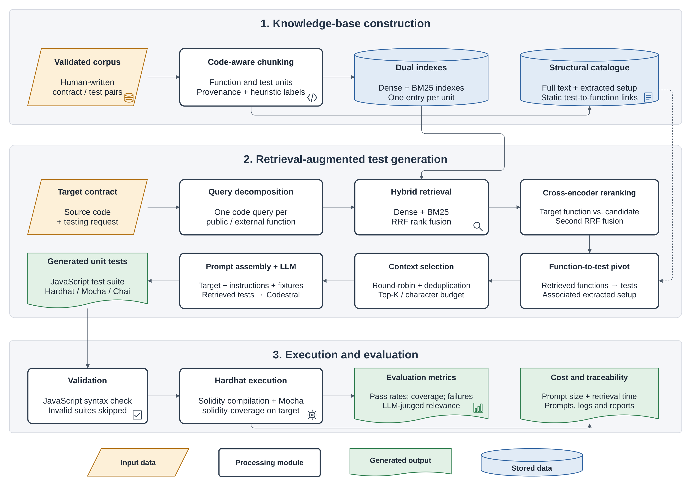

# Advanced-RAGUnitTest4SC — Replication package

Replication package of the paper *Advanced-RAGUnitTest4SC*, an extension of the ENASE 2026 paper on
RAGUnitTest4SC. It generates JavaScript unit tests (Hardhat / Mocha / Chai, ethers 6) for Solidity
smart contracts with an LLM (Codestral 2508), retrieving human-written tests from a validated corpus.



The approach has three stages (see [docs/approach.pdf](docs/approach.pdf)):

1. **Knowledge-base construction**: a frozen corpus of 225 human-written contract/test pairs, validated
   by execution, split into function and test units, indexed in dense and BM25 indexes, with a
   structural catalogue of test-to-function links.
2. **Retrieval-augmented test generation**: one code query per public/external function of the
   target, hybrid retrieval (dense + BM25, RRF), cross-encoder reranking, function-to-test pivot,
   round-robin context selection, and generation with Codestral.
3. **Execution and evaluation**: syntax check, Solidity compilation, Hardhat execution with
   solidity-coverage, fully passing suite rate (FPSR), test pass rate (TPR), coverage, failure
   categories, cost and retrieval relevance.

## Compared configurations

| Name in the paper | Folder suffix | Retrieval |
|---|---|---|
| LLM-only | `llm-only` | none |
| RAGUnitTest4SC | `rag-v2` | dense MiniLM retrieval of the original pipeline on the validated corpus + function-to-test pivot |
| Advanced-RAGUnitTest4SC | `advanced-v3` | per-function code queries, dense + BM25, RRF, cross-encoder, pivot, round-robin |

All three use the same prompt; only the block of retrieved tests differs. Generation: Codestral 2508,
temperature 0, seed 42, 4,096 output tokens. Benchmark: 30 contracts (`development14` used for
pipeline design, `heldout16` for confirmation), three repetitions each (270 suites).

## Repository layout

```
AdvancedRAG/
  advanced_rag/                 retrieval library (chunking, corpus v2 index, hybrid retrieval, reranking, pivot)
  corpus_v2/                    import, transformation and validation of corpus pairs
  build_corpus_v2_index.py      builds the index of the frozen corpus
  prepare_corpus_v2_prompts.py  builds the prompts of rag-v2 / advanced-v3
  run_generation_ethers6.py     generation + Hardhat execution of one campaign
  analyze_corpus_v2_campaign.py FPSR, TPR, coverage, McNemar tests, failure categories
  data/corpus-v2/               frozen corpus: CORPUS_FROZEN.json, corpus_manifest.json, md/, pairs/
  data/fixtures/v2/             benchmark fixtures supplied in the prompt
  outputs/
    <split>-<config>-ethers6-v1/        prepared prompts
    <split>-<config>-ethers6-v1-repNN/  one folder per contract: prompt.txt, retrieval-trace.json,
                                        generated.test.js, result.json, execution.log, reports
    corpus-v2-index-v1/          index catalogue and retrieval replay
    corpus-v2-campaign-figures/  figures of the paper (en/fr)
    cost-corpus-v2-v1/           token and time measurements
    retrieval-relevance-v1/      LLM-judge relevance ratings, with cached judge requests and responses
    ragas-corpus-v2-v1/          preliminary run with the standard RAGAS metrics
    CORPUS_V2_CAMPAIGN_RESULTS.md, corpus_v2_campaign_v1.json   campaign results
  tests/                        unit tests
evaluation/                     cost, relevance judge, RAGAS and plotting scripts
RAGUnitTest4SC-/                files added to the original RAGUnitTest4SC repository (see its README)
  data/benchmarks/enase30/      benchmark of 30 contracts with manifest and SHA-256 fingerprints
  src/main/resources/HardhatProject-ethers6/   frozen Hardhat project used for every execution
docs/approach.pdf               figure of the approach (draw.io source alongside)
```

## Setup

Tested on Windows 11 with Python 3.12 and Node.js 22.

```powershell
# Python environment (expected at RAGUnitTest4SC-\.venv by the campaign scripts)
python -m venv RAGUnitTest4SC-\.venv
RAGUnitTest4SC-\.venv\Scripts\pip install -r RAGUnitTest4SC-\requirements-runtime.txt
RAGUnitTest4SC-\.venv\Scripts\pip install -r RAGUnitTest4SC-\requirements-evaluation.txt   # judge / RAGAS only

# Node dependencies
cd AdvancedRAG; npm ci; cd ..
cd RAGUnitTest4SC-\src\main\resources\HardhatProject-ethers6; npm ci; cd ..\..\..\..\..

# Cross-encoder model (downloaded to AdvancedRAG\models\)
RAGUnitTest4SC-\.venv\Scripts\python AdvancedRAG\download_reranker.py

# API keys (never committed)
copy RAGUnitTest4SC-\.env.example RAGUnitTest4SC-\.env   # then fill MISTRAL_API_KEY (and GROQ_API_KEY for the judge)
```

## Reproducing the results

The stored outputs are sufficient to recompute every number of the paper without calling any API:

```powershell
cd AdvancedRAG
..\RAGUnitTest4SC-\.venv\Scripts\python analyze_corpus_v2_campaign.py        # FPSR, TPR, coverage, McNemar (RQ1-RQ3)
cd ..
RAGUnitTest4SC-\.venv\Scripts\python evaluation\measure_cost_corpus_v2.py    # tokens and time (RQ4)
RAGUnitTest4SC-\.venv\Scripts\python evaluation\judge_retrieval_relevance.py --report   # relevance (RQ5), from the cached judgments
RAGUnitTest4SC-\.venv\Scripts\python evaluation\plot_corpus_v2_campaign.py   # figures
cd AdvancedRAG; ..\RAGUnitTest4SC-\.venv\Scripts\python -m unittest discover -s tests
```

To regenerate the suites (requires a Mistral API key; scripts are resumable and reuse existing
generations when the prompt fingerprint is unchanged), run from `AdvancedRAG`:

```powershell
powershell -ExecutionPolicy Bypass -File outputs\run_llm_only_ethers6.ps1
powershell -ExecutionPolicy Bypass -File outputs\run_heldout16_llm_only_ethers6.ps1
powershell -ExecutionPolicy Bypass -File outputs\run_corpus_v2_campaign.ps1
powershell -ExecutionPolicy Bypass -File outputs\run_advanced_v3_campaign.ps1
```

Because the provider may change the model behind an API name, regenerated suites may differ from the
stored ones; the stored prompts, traces and outputs are the reference for the paper.

## Licence

The code and data of this repository are released under the MIT licence (see [LICENSE](LICENSE)),
except the corpus pairs described below.

## Corpus licences

The 225 corpus pairs (`AdvancedRAG/data/corpus-v2/pairs/`) are third-party code collected from public
GitHub repositories. Each pair keeps its original `LICENSE` file, and `corpus_manifest.json` records its
repository, commit, licence (212 MIT, 6 Apache-2.0, 4 GPL-3.0, 1 GPL-2.0, 1 LGPL-3.0, 1 Unlicense) and the
transformations applied to its tests. These files remain under their original licences.

## Related repositories

This work extends RAGUnitTest4SC by Feyza Sboui:

- https://github.com/Feyza-sboui/RAGUnitTest4SC-
- https://github.com/Feyza-sboui/RAGUnitTest4SC
- https://github.com/Feyza-sboui/smart-contracts-for-mutation-testing

`AdvancedRAG/vendor/baseline/rag_server.py` is the generation runtime of the original RAGUnitTest4SC,
reused so that all configurations share the same prompt construction.
